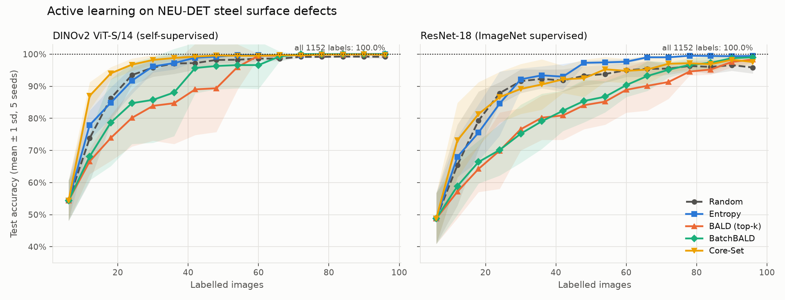
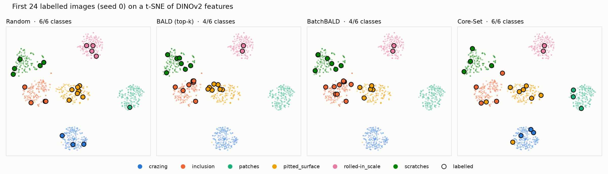

# Active Learning for Steel Surface Defect Classification

How few labelled images does a defect classifier need? This project benchmarks pool-based active
learning strategies on the **NEU-DET** steel surface defect dataset with
[BaaL](https://github.com/baal-org/baal) (Bayesian active learning) and frozen
[timm](https://github.com/huggingface/pytorch-image-models) backbones, and compares a
self-supervised representation (DINOv2) against a supervised one (ResNet-18).



## Key findings

- **Core-Set selection on self-supervised DINOv2 features is the most label-efficient strategy.**
  It reaches **96.7% test accuracy with 24 labels** and **99.6% with 48 labels**, which is about
  4% of the 1,152 training images. Training on all 1,152 labels gives 100%.
- **The representation matters more than the query strategy.** With random sampling, DINOv2
  features need 30 labels to reach 95% accuracy, compared with 60 labels for ResNet-18 features.
- **Top-k BALD fails at cold start.** Starting from only 6 labels, BALD and BatchBALD are *worse
  than random sampling* for the first 60 labels with DINOv2 and the first 80 labels with ResNet-18. They keep querying
  uncertain samples between a few overlapping classes and never query classes the model is
  confidently wrong about. After 24 labels, BALD has seen only 4 of the 6 classes (figure below).
  BatchBALD reduces the redundancy within a batch but does not fix the missing classes.
- **Once every class is represented, uncertainty sampling catches up.** With ResNet-18 features,
  Entropy sampling reaches 95% with 48 labels compared with 60 for random sampling, and ends
  at 99.4% against 95.8% for random sampling at 96 labels.



## Results

Test accuracy (mean ± 1 sd over 5 seeds), 288 held-out test images. "Labels to 95%" is the first
budget at which the mean curve reaches 95%.

| Backbone | Strategy | 24 labels | 48 labels | 96 labels | Labels to 95% |
|:--|:--|:--|:--|:--|--:|
| DINOv2 ViT-S/14 | Random | 93.5% ± 3.1% | 98.2% ± 1.1% | 99.2% ± 0.5% | 30 |
| DINOv2 ViT-S/14 | Entropy | 91.7% ± 4.1% | 99.2% ± 0.5% | 100.0% ± 0.0% | 30 |
| DINOv2 ViT-S/14 | BALD (top-k) | 80.1% ± 8.9% | 89.4% ± 13.6% | 100.0% ± 0.0% | 54 |
| DINOv2 ViT-S/14 | BatchBALD | 84.7% ± 12.7% | 96.3% ± 7.3% | 100.0% ± 0.0% | 42 |
| DINOv2 ViT-S/14 | **Core-Set** | **96.7% ± 1.9%** | **99.6% ± 0.5%** | 99.8% ± 0.2% | **24** |
| ResNet-18 | Random | 87.8% ± 3.4% | 93.3% ± 3.0% | 95.8% ± 1.9% | 60 |
| ResNet-18 | **Entropy** | 84.6% ± 10.0% | **97.3% ± 0.7%** | **99.4% ± 0.3%** | **48** |
| ResNet-18 | BALD (top-k) | 69.9% ± 11.9% | 84.1% ± 7.5% | 98.3% ± 1.0% | 84 |
| ResNet-18 | BatchBALD | 70.1% ± 8.0% | 85.4% ± 6.7% | 99.0% ± 0.8% | 72 |
| ResNet-18 | Core-Set | 86.6% ± 7.9% | 92.5% ± 5.8% | 97.6% ± 1.5% | 54 |

Upper bound with all 1,152 training labels: 100.0% for both backbones. Raw per-round results are
in [`results/curves.csv`](results/curves.csv).

## Method

| Component | Choice |
|:--|:--|
| Data | NEU-DET, 6 defect classes × 240 grayscale images (200 × 200 px); fixed stratified 80/20 split (1,152 pool, 288 test) |
| Backbones | `vit_small_patch14_dinov2.lvd142m` (self-supervised) and `resnet18.a1_in1k` (supervised), frozen, from timm |
| Classifier | MLP head (256 hidden units, dropout 0.5) on standardised features, wrapped in BaaL's `MCDropoutModule` |
| Uncertainty | 20 Monte Carlo dropout passes per prediction |
| Strategies | Random, Entropy, BALD (top-k), BatchBALD (BaaL heuristics), Core-Set (greedy k-center, own implementation) |
| Budget | 6 random initial labels, then 15 rounds of 6 queries (96 labels total); the head is retrained from scratch each round |
| Repeats | 5 seeds per configuration |

Features are extracted once and cached, so the whole benchmark runs on a CPU. The test set is
never queried.

## Limitations

- NEU-DET is a relatively easy dataset: both backbones reach 100% with all labels, so the
  differences between strategies only matter in the low-label regime (below about 60 labels).
- The backbones are frozen. Fine-tuning the backbone during active learning would change both the
  representation and the uncertainty estimates.
- The pool is small (1,152 images). Real annotation campaigns often have much larger pools,
  where BatchBALD's cost (about 40 s per query on a CPU here) becomes significant.
- A single train/test split is used; the 5 seeds vary the initial labels and training.

## Reproduce

```bash
python -m venv .venv
.venv/Scripts/activate            # Linux/macOS: source .venv/bin/activate
pip install -r requirements.txt
python scripts/download_data.py   # downloads and checksums NEU-DET (70 MB)
python scripts/extract_features.py
python scripts/run_experiments.py # about 70 min on a 4-core CPU, mostly BatchBALD; resumable
python scripts/plot_results.py
pytest
```

## Project structure

```
al_steel/
  data.py        NEU-DET loading and the fixed stratified split
  features.py    frozen timm backbones as feature extractors
  coreset.py     greedy k-center Core-Set selection
  loop.py        the BaaL active learning loop (MC Dropout, heuristics, evaluation)
scripts/         download, feature extraction, experiments, plots
tests/           unit tests for the split and Core-Set selection
results/         per-round results, summary table and figures
```

## References

- K. Song and Y. Yan, *A noise robust method based on completed local binary patterns for
  hot-rolled steel strip surface defects*, Applied Surface Science, 2013 (NEU-DET dataset).
- Y. Gal, R. Islam and Z. Ghahramani, *Deep Bayesian Active Learning with Image Data*, ICML 2017 (MC Dropout + BALD).
- A. Kirsch, J. van Amersfoort and Y. Gal, *BatchBALD: Efficient and Diverse Batch Acquisition for Deep Bayesian Active Learning*, NeurIPS 2019.
- O. Sener and S. Savarese, *Active Learning for Convolutional Neural Networks: A Core-Set Approach*, ICLR 2018.
- M. Oquab et al., *DINOv2: Learning Robust Visual Features without Supervision*, TMLR 2024.
- P. Atighehchian et al., *Bayesian active learning for production, a systematic study and a reusable library* (BaaL), 2020.

## License

MIT
